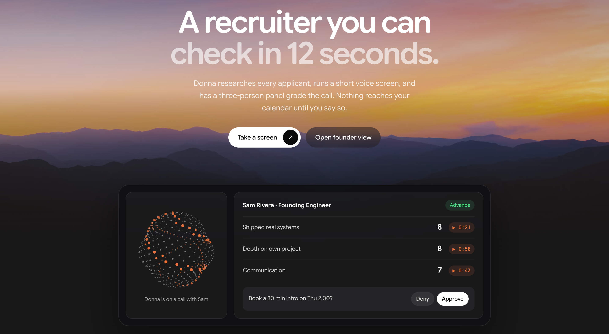
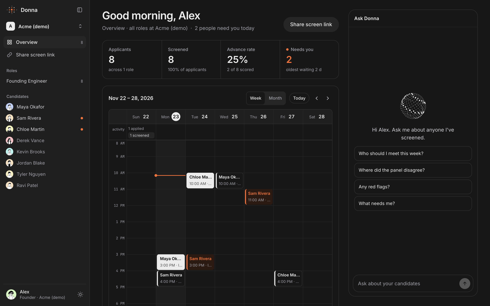
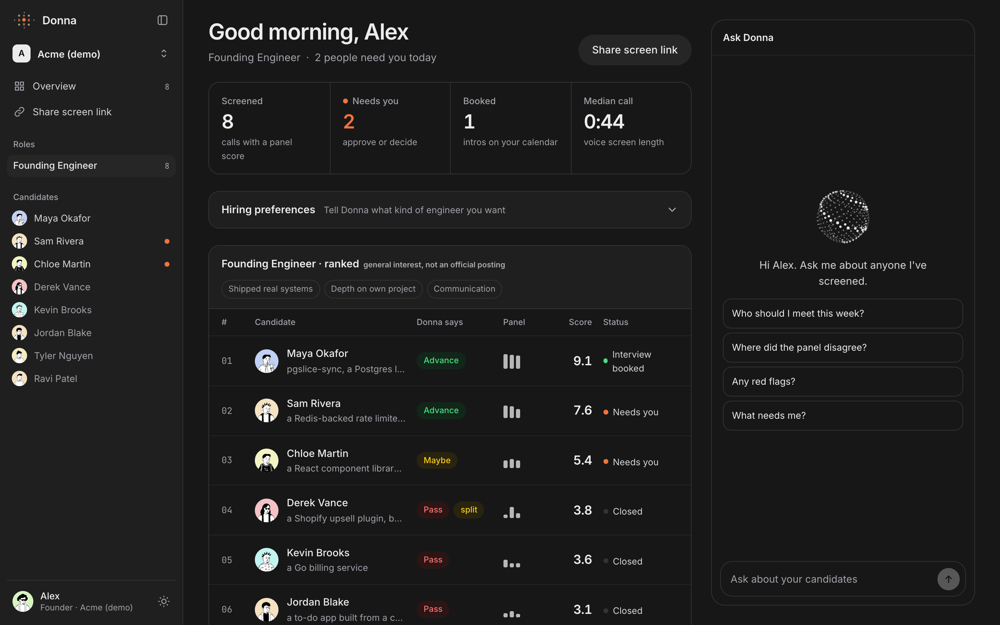
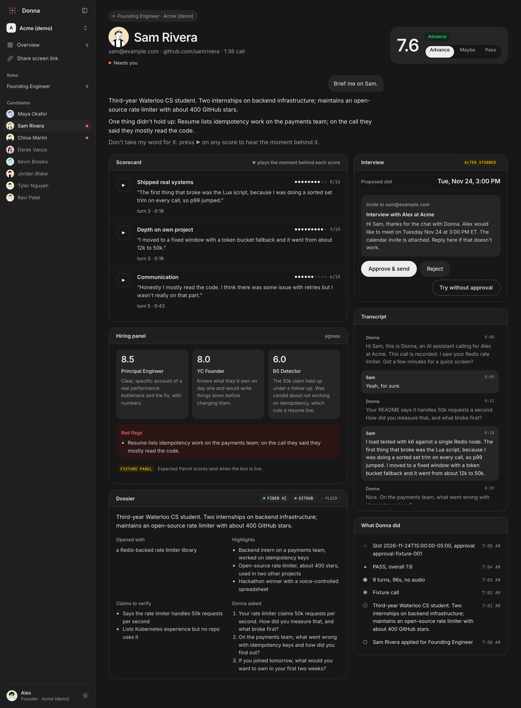
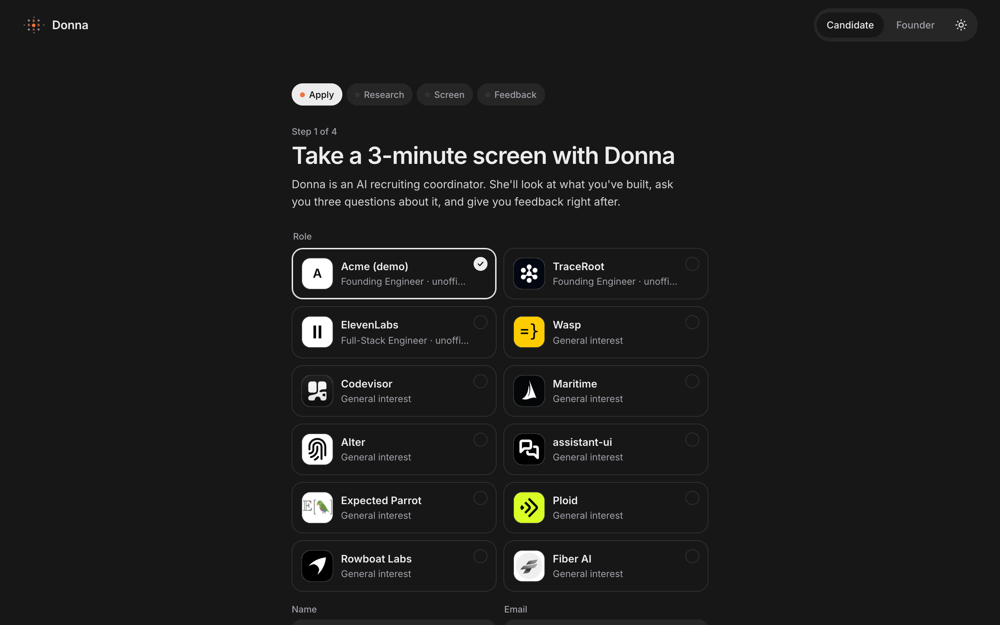
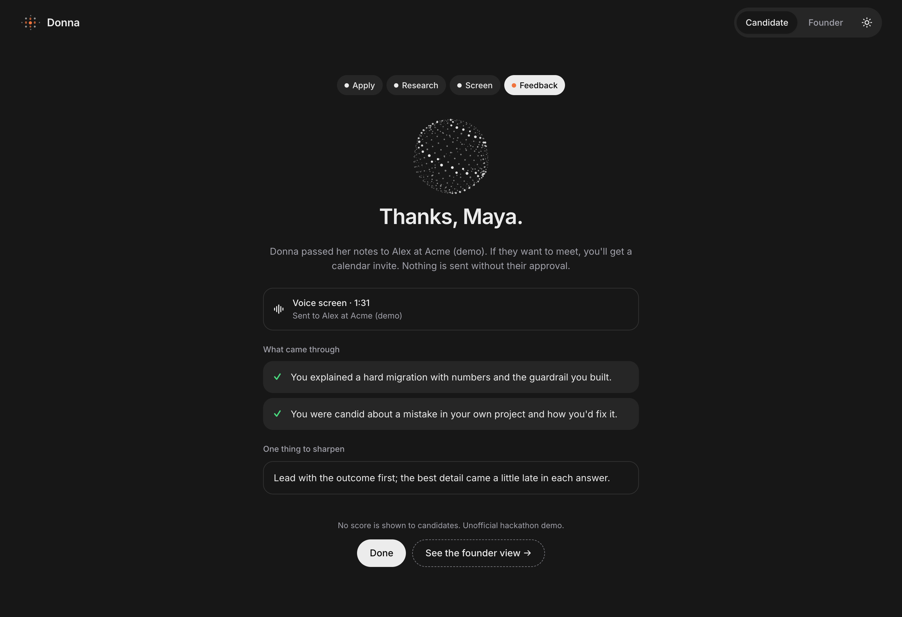

# Donna

**An AI recruiting coordinator you can check in 12 seconds.**

Donna researches each applicant, runs a short voice screen, and scores the call against the founder's rubric. Every score links to the exact seconds of audio it's based on, so you can check her work instead of trusting it. She proposes an interview slot, but she can't touch your calendar or email anyone until you approve, and that rule is enforced outside the model.

Built in one day at the YC Startups x ElevenLabs Hackathon (Waterloo, Nov 22 2026) for the challenge "An AI coworker you'd actually hire".

> Unofficial hackathon demo. The sponsor roles in the app are not real job postings, and applying through Donna is not an application to any company.



## What it does

### For the founder

**One page for the whole pipeline.** Applicants, screens, advance rate and who's waiting on you, next to a week calendar of intro calls. Ask Donna (right) answers questions about anyone she has screened.



**Ranked candidates per role.** Each candidate has Donna's recommendation, the reviewer panel's spread and an overall score. Hiring preferences (tech stack, work style, rubric weights) re-rank the list.



**Receipts, not vibes.** A candidate page opens with a two-line brief and what didn't hold up. Each rubric score quotes the candidate word for word, and ▶ plays that moment of the call. The interview card holds a drafted invite until you approve it. *Try without approval* shows the write being blocked.



### For the candidate

The candidate picks a role, agrees to research, and talks to Donna for about 3 minutes in the browser. Afterward they get honest feedback: what came through and one thing to sharpen. They never see a score.

| Apply | Feedback |
|---|---|
|  |  |

## How it works

```
apply + consent ─► research ─► voice screen ─► scoring ─► founder review ─► approval gate ─► invite
                  GitHub repos   ElevenLabs     scorer agent   receipts,      Alter (live) or
                  (Fiber AI in   agent, WebRTC  + quote check  ranked table   in-app gate
                   the box)
```

1. **Research.** If the candidate gives a GitHub username, Donna reads their public repos and writes a dossier with claims to verify and three tailored questions. The Python "box" service ([box/](box)) adds a work-history lookup with Fiber AI when it's connected.
2. **Voice screen.** An ElevenLabs Conversational AI agent runs the call over WebRTC from the browser. The server hands the browser a short-lived conversation token, plus dynamic variables (name, role, top project, tailored questions), so one agent runs a personal screen for every candidate.
3. **Scoring.** After the call, the server pulls the transcript, recording and analysis from ElevenLabs. A text-only ElevenLabs scorer agent (Claude Sonnet, temperature 0) grades the call against [agent/scoring-guidelines.md](agent/scoring-guidelines.md). Code checks every quote against the transcript and computes the overall score. If the scorer isn't set up, ElevenLabs' own call analysis is the fallback.
4. **Approval gate.** Booking an interview is a calendar write. In live mode it goes through Alter, which holds the founder's Google grant and keeps the write pending until a human approves. Approving lets Google send the invite. Without Alter, an in-app gate does the same job and is labelled as such.
5. **Tracing.** TraceRoot records one span per step (research, call fetch, evaluation, each approval step), with IDs only and no candidate data.

## Guardrails

These are product rules, enforced in the agent prompt and the code:

- Donna's first sentence says she is an AI and that the call is recorded.
- She never asks about age, family, origin, religion, health or other protected topics, and never promises an outcome.
- Research covers only the person who applied, uses only what they typed, and starts only after they tick the consent box.
- Nothing is written to a calendar and no email is sent without a recorded founder approval.

## Run it locally

You need Node.js and [Wasp 0.26.1](https://wasp.sh). From `app/`:

```bash
wasp install
```

```bash
cp .env.server.example .env.server
```

```bash
wasp db migrate-dev && wasp db seed
```

```bash
wasp start
```

Open http://localhost:3000. The founder view is at `/founder`, and `/dev` is a developer console. **Every integration falls back to fixtures when its key is empty**, so the app runs with no keys at all. The seed adds a demo company (Acme), a Founding Engineer role and eight sample candidates.

To make real calls, set `ELEVENLABS_API_KEY` and `ELEVENLABS_AGENT_ID` (agent setup is in [agent/settings.md](agent/settings.md)). The other keys are documented line by line in [app/.env.server.example](app/.env.server.example). To share the app with phones over HTTPS, see [dev2/RUNBOOK.md](dev2/RUNBOOK.md).

Checks, from `app/`:

```bash
npm run check:approval
```

```bash
npm run check:screen
```

## Built with

Only tools that ran during the hackathon are listed:

| Tool | What it does in Donna |
|---|---|
| [ElevenLabs](https://elevenlabs.io) | The live voice screen, the transcript and audio behind every ▶ receipt, the scorer agent and the Ask Donna chat agent |
| [Wasp](https://wasp.sh) | The full-stack app: React client, Node server, Prisma on SQLite |
| Alter | Holds the founder's Google Calendar grant and keeps the booking pending until approval (checked live; invites went only to the team's demo inbox) |
| TraceRoot | A tracing span per pipeline step |
| Fiber AI | Work-history lookup in the box service (ran live in the box; the app calls it only when `BOX_URL` is set) |
| Codevisor | Three changes were built by parallel agents in Codevisor. The rest was built with Claude Code |

## Status

Working:

- Real voice screens end to end: transcript with timestamps, stored recording, and ▶ on each score plays the quoted seconds.
- Scoring with quotes checked against the transcript, tested on seven scripted candidates ([dev2/test-screens](dev2/test-screens/README.md)). Scores can still move by a few points between runs.
- GitHub-based research and tailored questions.
- Approval gate, both in-app and live through Alter.

Not done yet:

- The three-persona reviewer panel (Expected Parrot, in the box) isn't connected to the app. Pages show a labelled fixture panel instead.
- Hiring preferences re-rank the dashboard but don't change Donna's questions yet.

## Repo layout

| Path | What |
|---|---|
| [app/](app) | The Wasp app: candidate flow (`src/candidate`), founder dashboard (`src/founder`), server and integrations (`src/server`) |
| [agent/](agent) | Donna's ElevenLabs agent: system prompt, settings, scoring guidelines, Ask Donna prompt |
| [box/](box) | Python research and evaluation service (Fiber AI, Expected Parrot panel) |
| [contracts/](contracts) | Shared TypeScript types |
| [fixtures/](fixtures) | Sample data every stubbed integration returns |
| [docs/](docs) | Screenshots, branching and submission notes, hackathon research |
| [plan.md](plan.md), [AGENTS.md](AGENTS.md), [BUILDLOG.md](BUILDLOG.md) | The hackathon plan, team rules for people and coding agents, and a timestamped log of every merge |
| `dev1/` to `dev4/` | Each team lane's PRD, guide and handoff notes |
